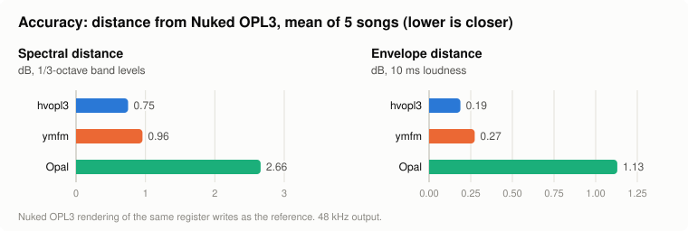
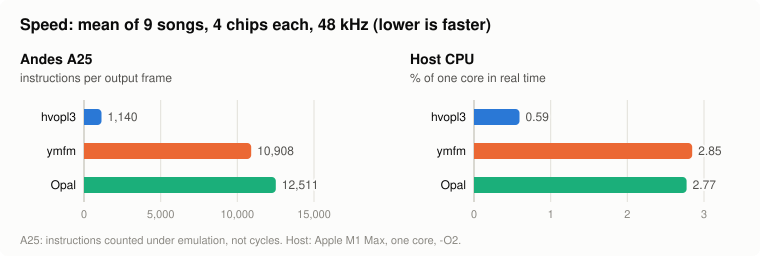

# hvopl3

A new FM synth modeled on the Yamaha OPL3 (YMF262), with accelerated RISC-V paths for
[Hira-V](https://hira-v.com).

hvopl3 is a from-scratch, BSD-licensed synthesizer for OPL3 music: the chip's register interface,
its 18 two-operator channels, four-operator voices, rhythm mode and OPL2 compatibility, rendered
directly at 48 or 96 kHz. It adds what a modern mixer needs on top: soft panning, reverb and chorus
sends, and per-voice gain. hvopl3 aims to balance YMF262 accuracy and precision with a design that
facilitates acceleration and quality enhancements.

## Highlights

- **Modeled on the chip's arithmetic.** Log-sine and exponent tables, envelopes, LFOs and noise run
  on the chip's own clock, mapped exactly onto the output rate. No resampler.
- **Native 48 and 96 kHz.** The 96 kHz mode is meant to be halved to 48 kHz by the caller, for less
  aliasing.
- **Mixer extensions.** Pan (0-127), reverb and chorus sends (0-127) and gain (0.75 dB steps) per
  channel, mixed into a dry output and two effect buses, each rounded once from the exact sum.
- **Optional high quality.** Three independent flags remove the chip's coarser steps where they are
  audible: whole-phase waves, smooth envelopes, unrounded modulation.
- **One output on every target.** A scalar C++ reference, plus accelerated RISC-V paths for various
  hardware platforms supported by Hira-V. These include the Andes DSP extension (Gowin AE350 / Andes
  A25 core), RVV 1.0 (Tenstorrent Blackhole / SiFive X280 core), RVV 0.7.1 (SOPHGO/SOPHON SG2042 /
  XuanTie/T-Head C920 core) and Zve32x.
  Every accelerated path produces exactly the reference's samples, in every mode.
- **Cost follows the music.** Silent voices are skipped without changing a sample; an idle chip costs
  one test per call.
- **Freestanding.** No allocation, no writable globals, nothing from the C library but `memset`.
  All state is one flat, caller-owned struct of 6 to 15 KB.

## Performance

Measured against independent OPL3 emulators on the same music. Accuracy is the mean distance from
Nuked OPL3's output over five songs. Speed is the mean cost over nine songs, four chips each. Methods
and per-song figures are in [docs/PERFORMANCE.md](docs/PERFORMANCE.md).

<picture>
  <source media="(prefers-color-scheme: dark)" srcset="docs/img/accuracy-dark.svg">
  
</picture>

<picture>
  <source media="(prefers-color-scheme: dark)" srcset="docs/img/speed-dark.svg">
  
</picture>

## Quick start

```cpp
#include "hvopl3.hpp"

static hvopl3::Chip chip;              // caller-owned state; no allocation inside
static int32_t dry[2 * 480];           // stereo interleaved: L, R, L, R, ...

void play_a_note() {
    hvopl3::init(chip, hvopl3::RATE_48K);
    hvopl3::write(chip, 0x105, 0x01);  // OPL3 mode
    hvopl3::write(chip, 0x20, 0x01);   // channel 0, modulator: multiple 1
    hvopl3::write(chip, 0x40, 0x3F);   //   ... silent (total level 63)
    hvopl3::write(chip, 0x23, 0x21);   // carrier: sustained, multiple 1
    hvopl3::write(chip, 0x43, 0x00);   //   ... full level
    hvopl3::write(chip, 0x63, 0xF0);   //   ... attack 15, decay 0
    hvopl3::write(chip, 0x83, 0x0F);   //   ... sustain 0, release 15
    hvopl3::write(chip, 0xC0, 0x30);   // left and right on, FM
    hvopl3::write(chip, 0xA0, 0x44);   // F-number 0x244, block 4: A4, 440 Hz
    hvopl3::write(chip, 0xB0, 0x32);   // key on

    const hvopl3::Output out = {dry, nullptr, nullptr, false};  // no effect buses
    for (int block = 0; block < 100; ++block) {                 // one second, 10 ms at a time
        if (hvopl3::render(chip, out, 480) & hvopl3::SOUNDED) {
            // dry[] holds 480 stereo frames in 16-bit range: hand it to the audio output
        }
    }
}
```

Build it with the library: `c++ -std=c++17 -O2 -ffp-contract=off -Isrc app.cpp src/hvopl3.cpp`.

## API

In `src/hvopl3.hpp`, namespace `hvopl3`:

| Call | |
|---|---|
| `init(chip, rate, flags)` | Reset a chip: `RATE_48K` or `RATE_96K` |
| `write(chip, reg, value)` | Write a register, `0x000`-`0x1FF` (two banks); in force at the next sample |
| `set_pan(chip, channel, pan)` | Pan a channel, 0 (left) to 127 (right), 64 centre |
| `set_sends(chip, channel, reverb, chorus)` | Reverb and chorus send levels, 0-127 |
| `set_gain(chip, channel, level)` | Gain in 0.75 dB steps, -32 to +32 |
| `set_flags(chip, flags)` | High-quality and output flags (below) |
| `render(chip, output, frames)` | Render frames into the dry output (written, or added to) and the buses (added to). Returns `SOUNDED` if any voice made sound |
| `play(chips, n, records, count, output, rate, flags)` | Replay an [HVO2](docs/TRACE-FORMAT.md) command stream into up to 32 chips |
| `advance(chip, frames)` | Keys and envelopes without samples: a shadow of a chip elsewhere |
| `inaudible(chip, channel)` | True when a released voice can make no more sound (its heard operators 72 dB down): free it early |
| `version()`, `version_string()` | The compiled library's version, e.g. `0.12.0` |

| Flag | |
|---|---|
| `HQ_PHASE` | Waves read at the whole phase, not the chip's table index |
| `HQ_ENVELOPE` | Envelope gain continuous, not in steps |
| `HQ_MODULATION` | Modulation and feedback unrounded |
| `NO_PAN_LAW` | Only the chip's own left/right bits, at unity |
| `NO_CLIP` | Dry output not clipped to 16 bits |

A C ABI covers the same calls (`hvopl3_init`, `hvopl3_write`, `hvopl3_render`, ...), with
`hvopl3_chip_size()` for callers that allocate the state themselves.

The header's version is in `HVOPL3_VERSION` (`"0.12.0"`), `HVOPL3_VERSION_MAJOR`, `_MINOR`, `_PATCH`
and `HVOPL3_VERSION_NUMBER` (`1200`, ordered as an integer). Comparing `HVOPL3_VERSION_NUMBER`
with `version()` detects a header used with a different build of the library.

## The MIDI driver: drv/

`drv/` is an optional MIDI driver that plays MIDI 1.0 on 1 to 32 hvopl3 chips (a build option: `-DHVOPL3_DRV_MAX_CHIPS=N`). It allocates voices
(2-op, 4-op and pseudo-4-op), maps instruments from WOPL banks, and turns controllers into register
writes and the mixer extensions. Its features:

- General MIDI's level curve, and per-program level corrections;
- percussion on any channel (GM2, GS, XG or the host);
- sample-accurate timing, the same samples in any block size;
- quiet voice stealing, and voices spread across the chips;
- a command-stream mode that emits HVO2 records for chips elsewhere.

Like the chip, it is freestanding, keeps its state in caller-owned structs, and gives the same samples
on every target. On the A25 it costs 2-5% of the chips' own cost. DMXOPL3's General MIDI bank (MIT)
is in `drv/banks/`.

```cpp
drv::Pool *pool = drv::pool_init(mem, drv::pool_bytes(16));
drv::load_wopl(*pool, wopl, wopl_size);
drv::Config cfg = drv::default_config(); cfg.chips = 4;
drv::init(driver, *pool, chips, cfg);
drv::send3(driver, frame, 0x90, 60, 100);            // Note On, at a frame of the next block
drv::render(driver, out, 480);
```

The API, every policy and the measured speed: [docs/DRIVER.md](docs/DRIVER.md).

## Building

Simply compile `src/hvopl3.cpp` as part of your project; the compiler's target flags select the
accelerated paths. Use `-ffp-contract=off` on every target, so the high-quality modes give the same
samples everywhere. Information on per-target flags, build options and memory use can be found in
[docs/BUILDING.md](docs/BUILDING.md).

## Testing

```sh
make -C tests          # unit tests: the chip and the driver
sh tests/plant.sh      # planted errors the tests must catch
sh tests/plant_drv.sh  # ... in the driver
```

The bench replays recorded or synthetic register traces, checks every accelerated path against the
scalar build bit for bit (under qemu for the vector targets, and under Hira-V's emulator for the
A25), and counts instructions per frame: [docs/TESTING.md](docs/TESTING.md).

## Status

0.12.0 adds `render_opl3`, a MIDI file renderer on the driver (`tools/`), sharing its host and
Hira-V's MIDI file reader with hvyxg's `render_yxg`. The chip's and the driver's samples are
unchanged from 0.11.0.

0.11.0 retires HVO1: HVO2 is the one trace format, and `play` reads it without a flag (`PLAY_HVO2`
is gone). Old HVO1 files convert with `tools/hvo1to2.py`, to the same samples. The chip's samples are
unchanged from 0.10.0.

0.10.0 added the MIDI driver (`drv/`), the HVO2 trace format (up to 32 chips), `advance()` and
`inaudible()`.

Bit-exact on every target under emulation, in chip mode and in every high-quality mode. Cycle
measurements on hardware boards are in progress. The C920 build is checked by compiling it, since
no available emulator runs RVV 0.7.1.

## Repository layout

| Path | |
|---|---|
| `src/` | The library |
| `drv/` | The MIDI driver (optional), its tables and DMXOPL3's bank |
| `tests/` | Unit tests and their planted errors |
| `bench/` | Trace player, comparison tools, vector and A25 test harnesses |
| `tools/` | `render_opl3` (a MIDI file through the driver to a WAV: `make -C tools`; `render/` its host, shared with hvyxg), table generators, and `hvo1to2.py` (old HVO1 traces to HVO2) |
| `docs/` | [Building](docs/BUILDING.md), [testing](docs/TESTING.md), [performance](docs/PERFORMANCE.md), [design](docs/DESIGN.md), [trace format](docs/TRACE-FORMAT.md), [the MIDI driver](docs/DRIVER.md) |

## License

Copyright (C) 2026 Kevin H. Patterson. Released under the BSD 3-Clause License: see
[LICENSE.txt](LICENSE.txt).

`src/hvopl3.cpp` adapts some tables and patterns from [ymfm](https://github.com/aaronsgiles/ymfm)
by Aaron Giles (BSD 3-Clause), whose notice it carries, and follows Opal (public domain) for the
vibrato steps.

`tools/render/lib/` holds copies of [Hira-V](https://hira-v.com)'s instrument interface and
Standard MIDI File reader (`software/lib/midi.hpp`, `midifile.*`), by the same author, released
here under the same BSD 3-Clause License; their references to `docs/` and `lib/` are to Hira-V's
tree. `tools/render/` is shared with [hvyxg](https://github.com/Hira-V/hvyxg)'s renderer.
