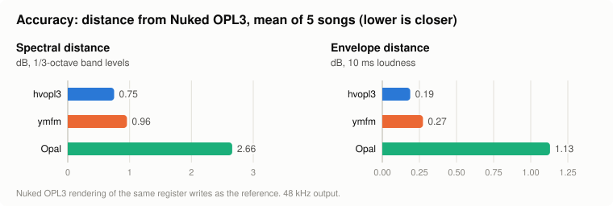
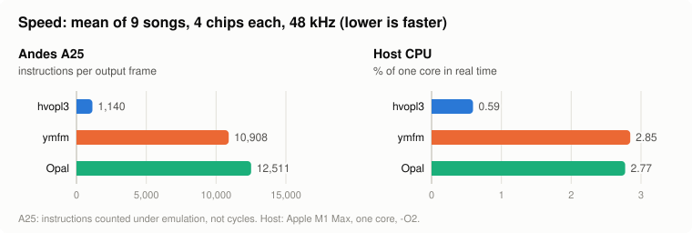

# Performance

How hvopl3 compares with three independent OPL3 emulators, measured on the same music. ymfm, Opal
and Nuked OPL3 are separate projects, used here only as points of comparison.

- **Nuked OPL3** is a cycle-accurate model of the YMF262, so its output serves as the reference
  for accuracy.
- **ymfm** and **Opal** are compared with hvopl3 for both accuracy and speed.

The music is nine 20-second recordings of seven General MIDI songs, each played through four chips
(72 voices):

- five songs use only the chip's own registers;
- four (two of them the same songs) are played through Hira-V's player, which also uses hvopl3's
  pan, send and gain extensions.

The player's register writes are recorded once and replayed into every emulator, so all of them
render exactly the same music.

## Accuracy

<picture>
  <source media="(prefers-color-scheme: dark)" srcset="img/accuracy-dark.svg">
  
</picture>

Each emulator's 48 kHz output is compared with Nuked OPL3's output for the same songs, after
matching the overall gain. Lower is closer:

- **Spectral distance**: the mean difference in 1/3-octave band levels over time, in dB. It shows
  differences in tone and timbre, and aliasing.
- **Envelope distance**: the mean difference in 10 ms loudness, in dB. It shows differences in the
  timing of attacks, decays, releases and tremolo.

The comparison uses only the five chip-only recordings. The other four also use the extensions,
which no other emulator has.

| Song | hvopl3 | ymfm | Opal |
|---|---:|---:|---:|
| a_chaotic_destiny | 1.83 / 0.50 | 1.10 / 0.34 | 1.96 / 1.11 |
| a_dubnesstopia | 0.32 / 0.11 | 0.62 / 0.15 | 1.76 / 0.75 |
| a_moon_p | 0.51 / 0.05 | 0.91 / 0.35 | 2.14 / 1.62 |
| a_orc4gm | 0.61 / 0.11 | 0.67 / 0.11 | 1.98 / 0.98 |
| a_trekmedg | 0.48 / 0.17 | 1.49 / 0.42 | 5.46 / 1.19 |
| **Mean** | **0.75 / 0.19** | **0.96 / 0.27** | **2.66 / 1.13** |

*Spectral / envelope distance, dB.*

**Output level.** hvopl3's output level matches the chip's to within 0.07 dB on every song. ymfm
and Opal run at their own output levels: about 9 dB and 1 to 4 dB above the chip's. The distances
above are measured after correcting for that difference.

## Speed

<picture>
  <source media="(prefers-color-scheme: dark)" srcset="img/speed-dark.svg">
  
</picture>

The mean cost of rendering 48 kHz stereo for all four chips, over all nine songs. Lower is faster.

| Song | A25: hvopl3 | ymfm | Opal | Host: hvopl3 | ymfm | Opal |
|---|---:|---:|---:|---:|---:|---:|
| a_chaotic_destiny | 610 | 9,104 | 11,503 | 0.33 | 2.60 | 2.38 |
| a_dubnesstopia | 154 | 7,678 | 10,742 | 0.07 | 2.32 | 2.17 |
| a_moon_p | 1,116 | 10,428 | 12,248 | 0.55 | 2.78 | 2.65 |
| a_orc4gm | 1,938 | 13,313 | 13,865 | 0.96 | 3.21 | 3.20 |
| a_trekmedg | 707 | 9,501 | 11,831 | 0.39 | 2.65 | 2.60 |
| b_human3gm | 1,807 | 14,001 | 14,151 | 1.00 | 3.27 | 3.46 |
| b_moon_p | 1,109 | 10,490 | 12,248 | 0.57 | 2.84 | 2.70 |
| b_nes_netopia_mix | 892 | 10,230 | 12,143 | 0.52 | 2.76 | 2.61 |
| b_orc4gm | 1,927 | 13,423 | 13,865 | 0.95 | 3.21 | 3.19 |
| **Mean** | **1,140** | **10,908** | **12,511** | **0.59** | **2.85** | **2.77** |

*A25: instructions per output frame. Host: % of one core in real time.*

**How the speed was measured**

- **Andes A25:** the instructions executed per output frame, counted under emulation (`rv32emu`,
  which models the A25 and its DSP extension), all built with `-mcpu=a25 -mext-dsp -O2`. These are
  counts, not cycles. hvopl3 uses its Andes DSP path; its portable scalar path takes 1,550
  instructions a frame on the same songs.
- **Host:** the time spent rendering, as a share of real time on one core of an Apple M1 Max. Same
  compiler for all three, `-O2`, best of three runs.
- **What each renders:** on the four songs that use the extensions, hvopl3 also mixes the reverb
  and chorus buses. ymfm and Opal render the dry output only, so their figures include less work.
- **Rates:** ymfm runs at the chip's own rate (49,716 Hz) and is brought to 48 kHz by linear
  interpolation. Opal resamples internally. hvopl3 renders at 48 kHz directly.

## Reproducing

The tools are in `bench/`: `play` renders a trace, `compare.py` computes the distances, and
`a25/run.sh` counts instructions. See [TESTING.md](TESTING.md). The song traces and the reference
renderings are not distributed with hvopl3.
